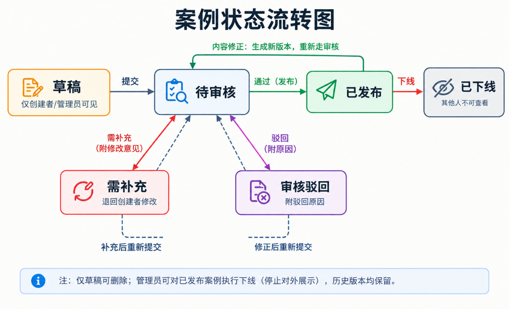

# 基于大语言模型的思政案例库信息化平台 · 需求规格文档

> 大学生创新创业训练项目 · 需求分析

| 项目 | 内容 |
| --- | --- |
| 学院 | 软件学院 |
| 年级 | 大三 |
| 组员 | 余燚、于林、王丝桐、刘澄宇 |
| 日期 | 2026-09-05 |
| 版本 | V1.0 |

> 需求分析也称为软件需求分析、系统需求分析或需求分析工程等，是开发人员经过深入细致的调研和分析，准确理解用户和项目的功能、性能、可靠性等具体要求，将用户非形式的需求表述转化为完整的需求定义，从而确定系统必须做什么的过程。

# 1.引言

## 1.1编写目的

### 1.1.1开发本平台的目的

在高校课程思政建设中，多数专业教师缺乏将思政元素有效融入课程教学的经验与素材，普遍面临"优质思政案例不足、备课门槛高、可借鉴案例查找与复用不便"的困难，思想政治教育与专业教学之间存在"两张皮"现象。

本平台旨在以信息化手段沉淀和共享优质课程思政案例资源，借助大语言模型的内容理解与生成能力，为教师提供"案例检索、辅助生成、智能问答"等备课与教学支持，降低课程思政案例建设的门槛与成本，促进思政教育元素与专业课程教学有机融合，实现课程思政案例的共建、共享与持续积累。

平台以真实、可追溯的案例为基础，坚持"AI 辅助、人工把关"原则：大模型仅承担内容生成与问答等辅助职能，所有案例经规范整理与管理员审核后方可发布使用，以保障内容的真实性与价值观正确性。

### 1.1.2编写本说明书的目的

描述"基于大语言模型的课程思政案例库信息化平台"的功能需求、数据需求、接口需求与非功能需求，作为平台开发、联调、测试及项目验收的依据。面向读者为项目开发成员、指导教师及项目验收人员。

### 1.1.3预期读者

开发团队（包括程序员、设计师）：用于指导系统开发实现；

测试人员：用于制定测试计划和验证系统功能；

需求方（如高校教师、学生等）：用于确认需求是否符合实际业务场景；

课程指导教师（针对学生开发项目）：用于评估项目可行性和需求完整性。

## 1.2项目背景

### 1.2.1项目名称

基于大语言模型的思政案例库信息化平台

### 1.2.2政策与教学背景

依据《高等学校课程思政建设指导纲要》等文件精神，课程思政要求将思想政治教育有机融入专业课程教学。实践中，多数教师缺乏将思政元素与专业知识深度融合的方法与素材，优质思政案例不足、备课成本高、资源分散，是制约课程思政落地的主要问题。

### 1.2.3已有基础

所在学院已建成课程思政案例信息管理系统，积累了约 108 个课程思政案例及一批课程思政点，具备一定的案例资源与使用经验，为本平台提供了数据与模式基础。

### 1.2.4技术条件

大语言模型具备较强的自然语言理解与生成能力；结合检索增强生成（RAG）、向量检索等成熟技术，可在已有案例资源基础上，实现案例的智能检索、辅助生成与知识问答。

### 1.2.5 建设目标

搭建一个以真实案例为主、支持案例共建共享与审核发布的信息化平台，借助大语言模型降低教师课程思政备课门槛，提高案例建设与使用效率，促进思政教育元素与专业教学的融合。

## 1.3 产品概述

### 1.3.1 产品定位

面向高校课程思政教学场景，构建集"案例资源汇聚、智能检索、辅助生成、智能问答、审核发布"于一体的课程思政案例库平台。平台以真实、可追溯的思政案例为核心数据资源，融合大语言模型能力，为教师开展课程思政案例建设与教学应用提供支撑。

### 1.3.2 目标用户

高校教师、学生及平台管理人员。

### 1.3.3 主要功能

1.案例资源汇聚

案例来源覆盖网络公开资料的采集整理、人工整理导入、教师自主上传及基于大语言模型的辅助生成，统一管理案例来源信息；

2.案例检索与浏览

教师与学生可按思政方向、专业、关键词等维度检索并查看已发布案例；

3.案例辅助生成

教师选择专业、思政方向，输入关键词，平台结合已有案例内容生成案例初稿，生成结果支持编辑修改并可提交进入入库审核流程；

4.案例智能问答

教师与学生可就某一条已发布案例进行提问，平台调用大语言模型基于该案例内容提供回答。

## 1.4术语说明

| 序号 | 术语 | 所指对象或含义 |
| --- | --- | --- |
| 1 | 课程思政 | 在专业课程教学中融入思想政治教育元素的教育理念与做法 |
| 2 | 思政元素/思政标签 | 案例中蕴含的价值观教育内容（如家国情怀、工匠精神等），本平台以标签形式组织 |
| 3 | 课程思政案例 | 以真实事件为基础、蕴含思政教学要素、可用于专业课程教学的案例，为本平台核心数据对象 |
| 4 | 已发布案例 | 经审核通过、可被师生检索、查看与问答的案例 |
| 5 | 案例辅助生成 | 由用户给出关键词、思政方向等条件，平台结合已有案例内容生成案例初稿的能力 |
| 6 | 案例智能问答 | 就某一条已发布案例内容进行提问，平台基于该案例给出回答的能力 |
| 7 | 辅助评价 | 平台依据既定维度对生成案例给出的初步评分与修改建议，不等同于审核结论 |
| 8 | 网络案例入库审核 | 管理员对所有网络爬取的案例进行AI辅助审核 |
| 9 | AI生成案例及手动输入的案例入库审核 | 管理员对AI生成的案例、手动输入的案例进行人工审核 |
| 10 | RAG（检索增强生成） | 先从案例库检索相关内容，再交由大语言模型生成回答或文本 |
| 11 | SSE | 服务端事件流，用于大模型回答的流式输出 |
| 12 | 来源方式 | 案例的获取途径分类：网络采集、人工导入、教师上传、AI 生成 |

# 2.用户角色与权限

## 2.1角色划分

平台设三类用户角色：学生、教师、管理员。各角色职责如下：

| 角色 | 职责 |
| --- | --- |
| 学生 | 检索、浏览与查看已发布案例，收藏案例，就案例进行问答 |
| 教师 | 在学生的全部能力之外，可创建、上传、编辑本人案例，使用案例辅助生成，提交入库审核并跟踪审核结果 |
| 管理员 | 在教师的全部能力之外，负责案例审核、全量案例与基础字典管理、用户管理及平台数据统计 |

## 2.2 账号管理

1.账号由管理员创建，平台不开放自助注册

2.新账号默认角色为学生；教师角色由管理员授予或调整

3.用户不可自行变更角色

4.管理员可冻结/解冻账号；账号冻结后不可登录，已签发的令牌同时失效

5.用户忘记密码时由管理员重置，平台不提供邮件等自助找回

6.关键操作（授予/调整角色、冻结账号、重置密码、案例审核）应保留操作记录，便于追溯。

## 2.3登录与会话

1.用户以“用户名+密码”登录，平台校验密码与账号状态；

2.登录成功签发短期访问令牌，令牌过期后需重新登录；

3.退出登录或令牌失效时清除本地令牌并回到登录页。

## 2.4权限矩阵

| 功能 | 学生 | 教师 | 管理员 |
| --- | --- | --- | --- |
| 登录、退出、个人信息、修改密码 | √ | √ | √ |
| 检索、浏览、查看已发布案例 | √ | √ | √ |
| 收藏 / 取消收藏 / 我的收藏 | √ | √ | √ |
| 已发布案例的智能问答 | √ | √ | √ |
| 案例辅助生成与生成记录 | × | √ | √ |
| 创建 / 上传 / 编辑 / 删除本人草稿、提交审核 | × | √ | √ |
| 查看本人案例的审核状态与意见 | × | √ | √ |
| 入库审核（通过 / 需补充 / 驳回，附意见） | × | × | √ |
| 全部案例管理、语料导入 | × | × | √ |
| 思政标签、专业字典管理 | × | × | √ |
| 用户管理、重置密码、账号冻结 | × | × | √ |
| 平台数据统计 | × | × | √ |

## 2.5权限实现要求

1.前端按角色显隐菜单与路由，仅用于改善交互体验，不作为安全边界；

2.后端对每个受保护接口执行角色与数据归属校验（如教师仅可维护本人案例）；

3.未登录访问受保护资源返回未认证（401），已登录但角色不足返回无权限（403）；

4.用户角色冻结或调整后，平台应确保其既有令牌不能继续访问受保护资源。

## 2.6 账号边界

平台账号体系与底层大模型引擎账号即MaxKB账号相互独立：平台内部管理用户角色与调用权限，不向用户暴露或共享底层引擎的密钥与凭据。

# 3.业务流程与案例生命周期

## 3.1总体业务流程

平台围绕案例的“产生-把关-使用”形成一条业务闭环，宏观流程如下：

| 环节 | 说明 | 主要角色 |
| --- | --- | --- |
| 1.资料采集 | 采集网络公开权威资料、整理既有语料 | 数据准备人员 |
| 2.内容整理 | 清洗、去重、结构化，形成符合字段规范的候选案例 | 数据准备人员 / 管理员 |
| 3.案例产生 | 教师上传；AI 辅助生成初稿并编辑保存为草稿 | 教师 |
| 4.入库审核 | 管理员人工审核（通过 / 需补充 / 驳回） | 管理员 |
| 5.发布使用 | 审核通过成为"已发布"，供师生检索、查看、问答 | 教师 / 学生 |
| 6.修订演进 | 内容修正产生新版本，重新走审核流程 | 教师 / 管理员 |

要点：

1. 任何来源的案例，入库就代表正式对外发布

2. 已发布案例是师生检索、查看与问答的对象；

3. 对已发布案例的实质修改会形成新版本并重新审核，历史版本予以保留，保证可追溯。

## 3.2案例生命周期与状态

### 3.2.1案例状态

| 状态 | 含义 | 可见范围 |
| --- | --- | --- |
| 草稿 | 新建或未填写完整，尚未提交 | 创建者 |
| 待审核 | 内容完整并已提交，等待管理员审核 | 创建者、管理员 |
| 需补充 | 管理员要求补充或修改，附修改意见 | 创建者、管理员 |
| 审核驳回 | 因原则性等问题未予通过，附驳回原因 | 创建者、管理员 |
| 已发布 | 审核通过，对外公开 | 全部用户 |
| 已下线 | 已发布的案例被管理员下线，不再对外展示 | 管理员 |

状态流转图如下：

### 3.2.2发布与修订

1. 对外检索、查看与问答仅面向已发布案例；

2. 同一案例在同一时刻对外展示其最新一个已发布版本；

3. 需要对已发布案例修改内容时，创建者或管理员基于该案例发起新版本并重新走审核流程，状态改为“需补充”；审核期间原已发布版本仍对外展示，新版本审核通过后切换为对外展示版本；

### 3.2.4 下线与删除

1. 管理员可对已发布案例执行下线：案例停止对外展示，下线原因记录在案；下线后可修正内容并重新提交审核发布；

2. 为保障内容可追溯，已发布的最新版本不可删除，新版本入库后覆盖旧版本；仅"草稿"状态支持删除。

## 3.3案例入库流程（四类来源）

### 3.3.1网络资料采集入库

数据准备人员使用采集工具收集网络公开的权威资料，经清洗、去重、结构化处理后形成符合平台字段规范的候选案例，再导入平台。导入后进入审核流程，审核通过方可发布。平台对采集来源、原文链接与采集时间予以保留。

### 3.3.2人工整理导入

将既有积累案例或整理后的资料按平台字段规范批量/逐条导入平台，进入审核流程。

### 3.3.3教师上传

教师在平台填写案例各字段或上传原文（文本/文档），平台辅助抽取正文后供教师核对补全，保存为草稿，再提交审核。

### 3.3.4 AI辅助生成入库

教师通过辅助生成得到案例初稿，编辑修改并确认符合规范后，将其保存为草稿并提交人工审核；AI 生成内容不因机器产生而免审。

## 3.4检索与浏览流程

用户在检索区按关键词、思政主题、专业等条件组合检索，系统仅返回已发布案例；用户可查看案例详情、收藏案例或对案例发起问答；检索无结果时，平台返回相应提示

## 3.5案例辅助生成流程

1. 教师输入生成条件：思政方向、专业、关键词等；

2. 平台从已发布案例库中检索相关内容作为参考；

3. 平台以流式方式生成案例初稿，并向教师展示所参考的库内案例；

4. 教师可重新生成、复制、修改或导出结果；

5. 教师将生成结果编辑修改后，保存为草稿并提交审核入库。

## 3.6案例智能问答流程

用户在已发布案例详情页就当前案例发起提问，平台基于该案例的内容（背景、过程、结果、思政元素、知识点、教学价值等）以流式方式作答，并给出内容依据；问答上下文限定在当前案例范围内。

## 3.7案例辅助评价

AI辅助生成多篇案例，可依据既定评价维度（思政相关性、内容质量等）给所有案例进行初步评分，筛选出最高分的案例进行展示。

# 4.功能需求

本章按业务模块列出功能需求。每条给出功能编号（FR-xx）、功能说明、优先级与允许角色。

优先级说明：高——第一版必须实现；中——第一版应实现；低——具备条件时实现。

## 4.1账号与权限

| 编号 | 功能 | 功能说明 | 优先级 | 允许角色 |
| --- | --- | --- | --- | --- |
| FR-01 | 用户登录 | 以用户名和密码登录，系统校验用户名与密码并签发访问令牌 | 高 | 全部 |
| FR-02 | 退出登录 | 用户退出，清除本地登录状态并回到登录页 | 高 | 全部 |
| FR-03 | 个人信息 | 查看并修改本人基本信息（用户名不可改） | 高 | 全部 |
| FR-04 | 修改密码 | 校验原密码后设置新密码 | 高 | 全部 |
| FR-05 | 权限校验 | 前端按角色控制页面与菜单可见性；后端对受保护接口校验角色与数据归属 | 高 | 全部 |
| FR-06 | 用户管理 | 管理员创建账号、调整学生/教师角色、冻结/解冻账号、重置密码 | 高 | 管理员 |
| FR-07 | 操作记录 | 对改角色、冻结、重置密码、审核等关键操作记录操作人、时间与结果 | 中 | 管理员 |

## 4.2案例检索与浏览

| 编号 | 功能 | 功能说明 | 优先级 | 允许角色 |
| --- | --- | --- | --- | --- |
| FR-10 | 多维检索 | 按关键词、思政标签、专业等条件组合检索已发布案例 | 高 | 学生、教师 |
| FR-11 | 列表排序与分页 | 案例列表支持排序（如按照发布时间）与分页展示 | 高 | 学生、教师 |
| FR-12 | 案例卡片 | 列表以卡片形式展示案例标题、分类、思政标签、专业、来源、发布时间等摘要信息 | 高 | 学生、教师 |
| FR-13 | 案例详情 | 查看案例完整内容（背景、过程、结果、思政元素、知识点、教学价值、来源与原文链接等） | 高 | 学生、教师 |
| FR-14 | 无结果引导 | 检索无结果时给出明确提示，并引导教师使用辅助生成 | 中 | 学生、教师 |
| FR-15 | 收藏与我的收藏 | 用户可收藏/取消收藏已发布案例，并查看本人收藏列表 | 高 | 学生、教师 |

## 4.3案例生产（教师工作区）

| 编号 | 功能 | 功能说明 | 优先级 | 允许角色 |
| --- | --- | --- | --- | --- |
| FR-20 | 新建草稿 | 教师创建案例草稿并填写字段内容 | 高 | 教师、管理员 |
| FR-21 | 编辑草稿 | 编辑本人尚未提交或被打回补充的草稿 | 高 | 教师、管理员 |
| FR-22 | 上传原文 | 上传本地文本或文档，系统辅助抽取正文与基本信息供教师核对补全 | 中 | 教师、管理员 |
| FR-23 | 提交审核 | 校验内容完整后提交，进入待审核 | 高 | 教师、管理员 |
| FR-24 | 我的案例 | 查看本人各状态（草稿/待审核/需补充/驳回/已发布）的案例 | 高 | 教师、管理员 |
| FR-25 | 查看审核意见 | 查看管理员给出的修改意见或驳回原因 | 高 | 教师、管理员 |
| FR-26 | 删除草稿 | 删除本人尚未进入审核的草稿 | 中 | 教师、管理员 |

## 4.4案例辅助生成

| 编号 | 功能 | 功能说明 | 优先级 | 允许角色 |
| --- | --- | --- | --- | --- |
| FR-27 | 设定生成条件 | 设定思政方向、关键词、适用专业等生成条件 | 高 | 教师、管理员 |
| FR-28 | 参考已有案例 | 生成时结合已发布案例库中相关内容作为参考 | 高 | 教师、管理员 |
| FR-29 | 流式输出 | 提交生成后，以 SSE 先推送过程状态（如"生成第 1/3 稿""评分中"），确定最优稿后流式输出其正文 | 高 | 教师、管理员 |
| FR-30 | 生成结果处理 | 可重新生成、复制、导出生成结果 | 高 | 教师、管理员 |
| FR-31 | 结果另存为草稿 | 将生成结果编辑修改后保存为案例草稿，用于进一步提交审核 | 高 | 教师、管理员 |
| FR-32 | 生成记录 | 保存并查看本人生成历史（含生成条件、结果、辅助评价、处理去向），可删除记录 | 高 | 教师、管理员 |
| FR-33 | 防重复提交 | 生成过程中防止重复操作，提供加载与失败提示 | 高 | 教师、管理员 |

## 4.5案例智能问答

| 编号 | 功能 | 功能说明 | 优先级 | 允许角色 |
| --- | --- | --- | --- | --- |
| FR-34 | 发起问答 | 在已发布案例详情页对当前案例提问 | 高 | 学生、教师 |
| FR-35 | 流式回答 | 回答流式展示，内容基于当前案例并注明依据 | 高 | 学生、教师 |
| FR-36 | 问答记录 | 保留本人问答记录供回看 | 中 | 学生、教师 |

## 4.6案例辅助评价（生成结果评价）

| 编号 | 功能 | 功能说明 | 优先级 | 允许角色 |
| --- | --- | --- | --- | --- |
| FR-37 | 多稿自动择优 | 平台按生成条件在内部生成多篇候选案例并对每篇评分，返回评分最高的一篇；分稿数、评分维度为服务端配置，不向用户暴露 | 高 | 教师、管理员 |
| FR-38 | 评价结果展示 | 随最优稿返回并展示其综合分、分项评分、问题说明与修改建议；在生成结果页与生成记录中均可查看 | 中 | 教师、管理员 |

## 4.7管理后台

| 编号 | 功能 | 功能说明 | 优先级 | 允许角色 |
| --- | --- | --- | --- | --- |
| FR-39 | 审核队列 | 管理员查看待审核案例列表并对每条做出通过 / 需补充 / 驳回处理，处理时填写审核意见 | 高 | 管理员 |
| FR-40 | 案例管理 | 查看、检索、编辑平台全部案例；对已发布案例执行下线 | 高 | 管理员 |
| FR-41 | 语料导入 | 按字段规范批量导入结构化案例数据，导入结果可核对 | 高 | 管理员 |
| FR-42 | 思政标签管理 | 维护思政标签（含层级），支持新增、编辑、停用 | 高 | 管理员 |
| FR-43 | 专业管理 | 维护专业字典，支持新增、编辑、停用 | 高 | 管理员 |
| FR-44 | 数据统计 | 查看案例总数、来源分布、审核待办、用户数等平台统计信息 | 中 | 管理员 |

（用户管理 FR-06/07 归属 4.1 账号与权限，不在此重复。）

## 4.8来源方式

平台为每条案例记录并展示其来源方式。用于卡片标注与统计：

| 来源方式 | 说明 |
| --- | --- |
| 网络采集 | 数据准备环节采集、清洗并结构化后导入 |
| 人工导入 | 整理既有语料后导入 |
| 教师上传 | 教师在平台手动填写并上传 |
| AI生成 | 经辅助生成后保存为草稿并入库 |

# 5.数据需求

## 5.1数据总体说明

平台以"案例"为核心数据对象。案例字段及填写规则以《项目知识库需求与数据规范文档》V1.1 为执行细则（本文档只列平台侧要求与差异）；另辅以基础字典（思政标签、专业、分类）与业务过程数据（用户、收藏、生成记录、审核记录、案例版本）。

## 5.2案例字段

| 编号 | 字段名 | 数据类型 | 说明 | 多值 | 必填时机 |
| --- | --- | --- | --- | --- | --- |
| 01 | 案例编号 id | 字符串 | 唯一编号，格式case_xxx | 否 | 创建时 |
| 02 | 标题 title | 字符串 | 如果原文有标题则保留，不夸大改写 | 否 | 提交审核前 |
| 03 | 分类 category | 字符串 | 人物案例 / 政策文件 / 行业案例 / 新闻资讯 / 专业资料 / 项目资料 | 否 | 提交审核前 |
| 04 | 来源 source | 字符串 | 发布的单位、网站或作者 | 否 | 提交审核前 |
| 05 | 原文链接 source_url | 字符串 | 原文网页地址，必须为真实、有效、可访问的链接 | 否 | 提交审核前 |
| 06 | 发布日期 publish_date | 日期 | 发布日期，格式YYYYMMDD； / 无法确认时不推测，标"待核实" | 否 | 提交审核前 |
| 07 | 采集日期 collect_date | 日期 | 采集/录入日期，格式YYYYMMDD；与 publish_date 含义不同 | 否 | 创建时 |
| 08 | 专业 profession | 字符串数组 | 相关专业领域；案例至少 1 个，AI 提取，优先使用专业名目录里的专业名；数量不设置上限 | 是 | 提交审核前 |
| 09 | 关键词 keywords | 字符串数组 | 检索关键词，用于案例检索与AI生成等，一般 3~8 个，优先专业术语；与 ideological_elements 区分 | 是 | 提交审核前 |
| 10 | 背景 background | 短文本 | 背景精简概括；与 process/result 区分，以原文事实为依据，一般一到两句话 | 否 | 提交审核前 |
| 11 | 内容 content | 字符串/链接 | PDF原文访问接口或PDF文件关联内容；接口完成前留空 | 否 | PDF 通道就绪后填写；缺原文标"待补 PDF"，不正式入库 |
| 12 | 过程 process | 摘要文本 | 实施过程精简概括，专业性强可适当放宽篇幅 | 否 | 提交审核前 |
| 13 | 结果 result | 短文本 | 成果/效果精简概括，原则上一句话 | 否 | 提交审核前 |
| 14 | 专业知识点 professional_knowledge | 字符串数组 | 具体专业知识点/技术原理，不填宽泛专业方向 | 是 | 提交审核前 |
| 15 | 思政元素/标签 ideological_elements | 字符串数组 | 与案例对应的思政教育元素，如“科技自立自强”，从固定的思政标签字典里取值 | 是 | 提交审核前 |
| 16 | 教学价值 teaching_value | 长文本 | 案例的教学应用价值 | 否 | 提交审核前 |
| 17 | 状态 review_status | 字符串 | 从3.2.1的案例状态里取值 | 否 | 创建时 |
| 18 | 版本 version | 字符串 | 数据所依据的文档的版本，原则上文档更新后所有数据都应遵循最新的文档；该字段仅供开发人员查看 | 否 | 创建时 |

一共18个字段，其中03分类、08专业、15思政元素从下文的固定范围内选取

## 5.3案例字段——分类category

| 取值 | 说明 |
| --- | --- |
| 任务案例 | 以具体人物或人物群体为核心，重点介绍其事迹、经历、贡献、成长过程、先进事例或典型经验 |
| 政策文件 | 由党政机关、政府部门或相关组织发布的政策、法规、规划、意见、通知、办法、标准等规范性或指导性文件 |
| 行业案例 | 以某一行业发展、应用或典型实践为核心，重点反映行业现状、行业经验、行业趋势，不以单个项目的实施过程为主要对象 |
| 新闻资讯 | 以新闻事件、最新动态、活动报道、会议消息、发布消息或时事信息为核心，重点反映事件的发生或进展，不以系统介绍政策、项目或人物事迹为主要目的 |
| 专业资料 | 以专业知识、学术研究、技术原理、理论方法、教学资料、研究报告或专业文献为核心，主要用于知识学习和专业参考 |
| 项目资料 | 以具体项目为核心，重点介绍项目背景、建设目标、实施过程、技术路线、成果效果或项目经验。项目应具有明确名称、建设任务、实施主体或实施周期 |

## 5.4案例字段——专业profession

## 5.5案例字段——思政元素ideological elements

| 序号 | 一级标签 | 说明 | 二级标签 |
| --- | --- | --- | --- |
| 01 | 科技自立自强 | 摆脱外部依赖，实现核心技术自主掌控，保障国家发展与安全 | 自主可控、国产替代、核心技术自主研发 |
| 02 | 自主创新 | 依靠自身力量进行原始创新、集成创新，不受制于人 | 自主设计、自主研发、原始创新 |
| 03 | 科技报国 | 将个人/团队科研工作与国家需求结合，以科技贡献服务国家 | 科技强国、产业报国、科学报国 |
| 04 | 攻坚克难 | 面对重大技术瓶颈、极端条件或资源限制，坚持不懈、迎难而上 | 挑战极限、追求卓越、十年磨一剑 |
| 05 | 团结协作 | 多单位、多学科、多团队协同攻关，以集体力量推动重大突破 | 协同攻关、产业链协同 |
| 06 | 严谨求实 | 治学与科研严谨细致、以事实为依据，不弄虚作假 |  |
| 07 | 工匠精神 | 对待工作精益求精、追求极致品质 | 精益求精 |
| 08 | 家国情怀 | 个人命运与国家、民族命运相连，以国家和人民利益为重 | 无私奉献、立德树人 |
| 09 | 责任担当 | 关键时刻主动作为、敢于负责、甘于奉献 |  |
| 10 | 国际合作 | 坚持开放共享，在平等互惠基础上开展国际合作与交流 | 开放合作、开放共享、共建"一带一路" |
| 11 | 人民至上 | 科技与教育成果惠及人民，以人民需求为导向 | 教育公平 |
| 12 | 创新驱动发展 | 以科技创新引领产业升级和经济社会高质量发展 |  |
| 13 | 文化自信 | 传承和弘扬中华优秀传统文化、革命文化、社会主义先进文化 | 文化传承、中华文明、文化强国、传统美德、文化认同 |
| 14 | 诚实守信 | 言行一致、遵守承诺、恪守学术规范和职业道德 | 学术诚信、守诺践约、诚信为本、契约精神 |
| 15 | 法治精神 | 树立法治意识，遵守法律法规，维护社会公平正义 | 依法治国、法律意识、公平正义、知法守法 |
| 16 | 生态文明 | 树立人与自然和谐共生的理念，关注环保与可持续发展 | 绿色发展、碳达峰碳中和、环境保护、可持续发展、生态平衡 |
| 17 | 艰苦奋斗 | 不畏艰难、勤俭节约、自强不息、砥砺前行 | 自强不息、勤俭节约、艰苦创业、永不言弃 |
| 18 | 开拓进取 | 敢为人先、勇立潮头、不断探索未知领域 | 敢为人先、勇攀高峰、锐意进取、敢闯敢试 |

## 5.6业务过程数据

用户账号、案例版本、审核记录（审核人/时间/结果/意见，含下线原因）、收藏、生成记录（含辅助评价）、问答记录（可选）。

## 5.7数据规则

1.来源

按权威性优先级选择；纳入须可识别发布单位、可获标题/日期/正文、有可访问原文链接、与主题相关、事实可追溯；排除链接失效且无替代、高度重复、来源不明、自媒体/论坛、涉广告、涉密/隐私等；

2.内容

background/process/result 精简、相互不重复、以原文事实为依据，不写未经证实结论；content 存原文关联而非重复正文；

3.区分原则

专业 ≠ 专业知识点；关键词 ≠ 思政元素；分类 ≠ 专业/关键词/思政；

4.审核把关

入库须过敏感词过滤、价值观检测与格式校验，管理员人工终审兜底；

5.版本与历史

案例新版本自动覆盖旧版本；修改正文/来源/日期/核心要素时版本号递增，仅改关键词/格式用修订号；每次修改记录修改人与时间；

6.失效处理

失效数据不删除，转"已下线"并保留记录。

# 6.接口需求

## 6.1总体约定

1.统一前缀

所有业务接口使用版本化前缀 /api/v1

2.数据格式

请求与响应均采用 JSON；日期类字段按 YYYYMMDD 传递（与数据字段一致）。

3.统一相应结构

业务响应统一为 { code, message, data }。code 表示业务状态（0 为成功）；非 0 的 code 与 message 供前端提示定位。

4.分页结构

分页返回统一为 data: { records, total, page, size }

5.鉴权

除登录等公开接口外，请求需携带 Authorization: Bearer {token}

401 未登录或令牌失效；403 已登录但角色/归属不足；404 资源不存在；500 服务异常

6.越权规则

涉及"本人数据"的接口由后端按当前登录用户归属校验（如教师仅可操作本人案例），不依赖前端隐藏入口

7.流式输出

AI 生成、智能问答采用 SSE 流式返回

8.各接口的请求/响应字段、参数与错误码明细，在接口设计文档（契约）中进一步定义；本章仅列出接口清单与访问角色

## 6.2账号与权限接口

| 编号 | 接口（草案路径） | 方法 | 说明 | 访问角色 | 对应功能 |
| --- | --- | --- | --- | --- | --- |
| 01 | /auth/login | POST | 登录，校验账号密码，返回令牌 | 公开 | FR-01 |
| 02 | /auth/logout | POST | 退出登录，失效当前令牌 | 全部登录用户 | FR-02 |
| 03 | /users/me | GET | 获取本人信息 | 全部登录用户 | FR-03 |
| 04 | /users/me | PATCH | 修改本人基本信息（登录名不可改） | 全部登录用户 | FR-03 |
| 05 | /users/me/password | PUT | 修改本人密码（校验原密码） | 全部登录用户 | FR-04 |
| 06 | /users | POST | 管理员创建账号 | 管理员 | FR-06 |
| 07 | /users/{id} | PATCH | 调整角色、冻结/解冻账号 | 管理员 | FR-06 |
| 08 | /users/{id}/reset-password | POST | 重置指定账号密码 | 管理员 | FR-06 |
| 09 | /audit-logs | GET | 查询关键操作记录（角色调整、冻结、重置、审核等） | 管理员 | FR-07 |

## 6.3案例检索、浏览与收藏接口

| 编号 | 接口（草案路径） | 方法 | 说明 | 访问角色 | 对应功能 |
| --- | --- | --- | --- | --- | --- |
| 10 | /cases | GET | 检索已发布案例，支持关键词、思政标签、专业等组合条件，含排序分页 | 学生、教师、管理员 | FR-08/09/10 |
| 11 | /cases/{id} | GET | 获取已发布案例详情 | 学生、教师、管理员 | FR-11 |
| 12 | /cases/{id}/favorite | POST | 收藏案例 | 学生、教师、管理员 | FR-13 |
| 13 | /cases/{id}/favorite | DELETE | 取消收藏 | 学生、教师、管理员 | FR-13 |
| 14 | /users/me/favorites | GET | 我的收藏列表 | 学生、教师、管理员 | FR-13 |

## 6.4案例生产接口（教师工作区）

| 编号 | 接口（草案路径） | 方法 | 说明 | 访问角色 | 对应功能 |
| --- | --- | --- | --- | --- | --- |
| 15 | /cases | POST | 新建案例草稿 | 教师、管理员 | FR-14 |
| 16 | /cases/{id} | GET | 获取本人案例（含各状态） | 教师、管理员（仅限本人） | FR-18 |
| 17 | /cases/{id} | PATCH | 编辑本人草稿/被打回补充的案例 | 教师、管理员（仅限本人） | FR-15 |
| 18 | /cases/{id} | DELETE | 删除本人草稿（仅草稿可删） | 教师、管理员（仅限本人） | FR-20 |
| 19 | /cases/{id}/submit | POST | 提交审核，进入待审核 | 教师、管理员（仅限本人） | FR-17 |
| 20 | /cases/parse | POST | 上传文本/文档并返回抽取的候选字段 | 教师、管理员 | FR-16 |
| 21 | /users/me/cases | GET | 本人全部案例及各状态列表 | 教师、管理员 | FR-18 |
| 22 | /cases/{id}/review | GET | 查看该案例的审核结果与审核意见（状态、审核人、时间、意见），仅本人及管理员可查 | 教师、管理员（仅限本人） | FR-19 |

## 6.5 AI案例生成与辅助评价接口

| 编号 | 接口（草案路径） | 方法 | 说明 | 访问角色 | 对应功能 |
| --- | --- | --- | --- | --- | --- |
| 23 | /ai/generate | POST(SSE) | 按生成条件执行"多稿生成 + 逐稿评分 + 择优"；SSE 先推送过程事件（分稿进度/评分中），确定最优稿后流式返回其正文，结束携带辅助评价（综合分/分项分/修改建议）与参考案例 | 教师、管理员 | FR-21~24、31、32 |
| 24 | /ai/records | GET | 本人生成历史列表 | 教师、管理员 | FR-26 |
| 25 | /ai/records/{id} | GET | 单条生成记录详情（含生成条件、结果、辅助评价） | 教师、管理员 | FR-26/31/32 |
| 26 | /ai/records/{id} | DELETE | 删除生成记录 | 教师、管理员 | FR-26 |

## 6.6 AI智能问答接口

| 编号 | 接口（草案路径） | 方法 | 说明 | 访问角色 | 对应功能 |
| --- | --- | --- | --- | --- | --- |
| 27 | /ai/ask/{caseId} | POST（SSE） | 就指定已发布案例提问，流式回答 | 学生、教师、管理员 | FR-28/29 |
| 28 | /users/me/ask-records | GET | 本人问答记录 | 学生、教师、管理员 | FR-30 |

## 6.7管理后台接口

| 编号 | 接口（草案路径） | 方法 | 说明 | 访问角色 | 对应功能 |
| --- | --- | --- | --- | --- | --- |
| 29 | /admin/reviews | GET | 待审核案例队列 | 管理员 | FR-33 |
| 30 | /admin/cases/{id}/review | POST | 审核：通过 / 需补充（附意见）/ 驳回（附原因） | 管理员 | FR-33 |
| 31 | /admin/cases | GET | 全部案例查询（含各状态） | 管理员 | FR-34 |
| 32 | /admin/cases/{id} | PATCH | 编辑/维护案例 | 管理员 | FR-34 |
| 33 | /admin/cases/{id}/offline | POST | 已发布案例下线（附原因） | 管理员 | FR-34 |
| 34 | /admin/cases/import | POST | 按字段规范批量导入案例数据 | 管理员 | FR-35 |
| 35 | /admin/cases/export | GET | 按条件导出案例 | 管理员 | FR-35 |
| 36 | /admin/tags | GET/POST | 思政标签查询/新增 | 管理员（查询可开放给师生） | FR-36 |
| 37 | /admin/tags/{id} | PATCH | 编辑、停用思政标签 | 管理员 | FR-36 |
| 38 | /admin/professions | GET/POST | 专业字典查询/新增 | 管理员（查询可开放给师生） | FR-37 |
| 39 | /admin/professions/{id} | PATCH | 编辑、停用专业 | 管理员 | FR-37 |
| 40 | /admin/statistics/home | GET | 平台统计信息（案例总数、来源分布、待审核数、用户数等） | 管理员 | FR-38 |

# 7.非功能需求

## 7.1范围与口径说明

本章指标按本期验收规模设定（而非面向大型生产系统）：案例数据量以数百至千级为验收口径，部署面向课堂/演示环境；如后续扩大规模，需另行核定。

## 7.2性能需求

| 编号 | 需求项 | 指标/口径 | 说明 |
| --- | --- | --- | --- |
| 01 | 案例数据规模 | 数百 ~ 千级为验收口径 | 设计上预留扩容空间，不承诺万级性能 |
| 02 | 列表 / 详情 / 检索响应 | 演示环境 P95 ≤ 2s（目标 <1s） | 不含大文件上传 |
| 03 | AI 生成案例：首个进度事件 | ≤ 3s | 用户点击后能尽快看到"已开始/生成中"反馈 |
| 04 | AI 生成案例：正文首段 | 目标 ≤ 20s（按实际模型与分稿数标定） | 需先内部多稿择优，故正文首段晚于原单稿流式 |
| 05 | AI 问答：回答首段 | 目标 ≤ 10s（按实际模型标定） | - |
| 06 | 并发 | ≥ 20 个常规页面/检索请求同时进行可正常响应 | 面向课堂演示规模 |
| 07 | 运行资源 | 单机演示环境即可运行 | 服务端配置见部署要求 |

说明：AI 生成因"内部多稿生成 + 逐稿评分 + 择优"而存在选稿等待，首段正文指标相应放宽，并以过程事件保持用户反馈；具体数值在模型与分稿数确定后进行标定。

## 7.3安全需求

| 编号 | 需求项 | 要求 |
| --- | --- | --- |
| 01 | 账号安全 | 密码以散列形式存储；登录校验账号状态；访问令牌短期有效 |
| 02 | 权限控制 | 后端对每个受保护接口执行角色与数据归属校验，不依赖前端隐藏入口；未登录 401、越权 403 |
| 03 | 密钥管理 | 大模型/引擎密钥等仅保存在服务端，不进入前端、日志与上传文件 |
| 04 | 传输安全 | 公开部署时应采用 HTTPS |
| 05 | 内容安全 | 入库内容经过敏感词、价值观与格式校验；管理员人工终审兜底 |
| 06 | 审计 | 改角色、冻结、重置密码、审核等关键操作保留操作记录 |
| 07 | 数据与隐私 | 仅采集业务必要信息；导入/示例数据脱敏，不含隐私与版权风险内容 |

## 7.4可用性与易用性

1. 界面全中文；对加载、空数据、操作失败、无权限等场景提供明确提示；

2. 长耗时操作（AI 生成、上传解析）提供进度反馈，并防止重复提交；

3. 出错信息面向用户可理解，同时服务端日志可定位排查。

## 7.5可靠性需求

| 编号 | 场景 | 处理要求 |
| --- | --- | --- |
| 01 | 大模型/引擎不可用 | AI 生成、问答等功能给出"暂不可用"降级提示；非 AI 功能不受影响 |
| 02 | 模型超时 / 返回为空 / 缺字段 | 接口侧兜底处理，返回可理解错误，前端不崩溃 |
| 03 | 检索结果为空 | 给出空结果提示，并按规则引导 |
| 04 | 数据备份 | 提供业务数据库与文件数据的备份与恢复方案，并实际验证可恢复 |
| 05 | 故障恢复 | 本地开发与演示环境可按文档步骤快速恢复运行 |

## 7.6可维护性与兼容性

1. 前后端按接口契约开发与联调，前端可基于模拟数据独立开发，切换真实接口不改变前端结构；

2. 字段、状态与接口变更须同步更新文档并通知受影响成员，避免多版本并存；

3. 浏览器：支持主流现代桌面浏览器（如 Chrome、Edge 最新稳定版）。

## 7.7合规与质量

1.来源可追溯

案例保留来源单位与原文链接，事实可溯源；采集遵循来源优先级与纳入/排除标准（见第 5 章数据规则）；

2.尊重版权

原文以链接/原文关联方式提供，不擅自复制传播受版权保护全文；

3.价值观正确性

AI 生成与入库内容符合主流价值观，经校验与人工审核；

4.字段质量

案例字段遵循数据规范的填写规则与相互区分原则。

# 8.验收标准

## 8.1账号与权限

1. 学生、教师、管理员三角色可登录与退出；未登录访问受保护页面跳转登录页；

2. 学生不可进入 AI 生成与后台功能，教师不可进入后台；直接调用越权接口返回 403；

3. 教师仅能操作本人案例（他人案例越权操作被拒绝）；

4. 管理员可创建账号、调整学生/教师角色、冻结/解冻、重置密码；冻结账号无法继续访问受保护接口；

5. 个人可查看/修改本人信息与修改密码（校验原密码）。

## 8.2检索、浏览与收藏

1. 支持关键词 + 思政标签 + 专业的组合检索，仅返回已发布案例；

2. 列表排序与分页正常；案例卡片、详情内容与字段展示正确；

3. 检索无结果时给出提示并按规则引导；

4. 收藏/取消收藏/我的收藏可正常增删查。

## 8.3案例生产（教师工作区）

1. 可新建/编辑草稿、查看本人各状态案例、提交审核；

2. 上传文本/文档后能返回抽取的候选字段并预填，教师可修改；抽取异常可手工填写兜底；

3. 草稿提交前进行必填完整性校验；

4. 教师可查看需补充意见与驳回原因；仅草稿可删除，进入审核流程后不可删除；

5. 案例归属校验生效：教师看不到、改不了非本人案例。

## 8.4 AI案例生成与评价

1. 按生成条件发起生成，界面能收到过程进度（分稿/评分中）反馈；

2. 最优稿正文流式输出；结果展示综合分、分项评分、修改建议与参考案例；

3. 可重新生成、复制、导出；可将结果编辑后保存为草稿并提交审核；

4. 生成记录可查看（含生成条件、最优稿、评分建议）、可删除；

5. 生成过程防重复提交；失败/超时有明确提示。

## 8.5 AI智能问答

1. 可对已发布案例发起问答，回答流式且基于该案例内容并给出依据；

2. 问答记录可查看（若本期实现）。

## 8.6管理后台

1. 审核队列可对待审核案例执行通过 / 需补充（附意见）/ 驳回（附原因）；

2. 审核结果与意见能回显给提交人；通过后案例成为已发布、对外可检索；

3. 全部案例管理（查看、检索、编辑）可用；可对已发布案例执行下线并附原因；

4. 结构化语料可批量导入并核对；可按条件导出；

5. 思政标签（含层级）、专业字典可新增/编辑/停用，停用不影响历史关联；

6. 用户管理与平台统计（案例总数、待审核数、用户数等）可用。

## 8.7状态流转与数据规则

1. 草稿 → 待审核 → 已发布 / 需补充 / 审核驳回 各流转正确，下线 → 修正后重新提交正常；

2. 仅已发布案例对外可见；已下线案例停止对外展示；

3. 历史版本与审核记录保留，修改不覆盖原内容；

4. 案例字段符合数据规范的 18 字段及填写规则（必填时机、YYYYMMDD、publish_date 无法确认标"待核实"、缺原文标"待补 PDF"等）。

## 8.8非功能与可靠性

1. 检索/列表/详情在演示环境满足第 7 章性能口径；

2. AI 生成与问答给出进度/流式反馈，且在模型不可用时降级提示、非 AI 功能不受影响；

3. 空数据、加载中、操作失败、无权限均有明确提示，前端不崩溃；

4. 按文档完成一次数据备份与恢复验证；

5. 公开演示路径不暴露服务端密钥与凭据。

## 8.9整体闭环与交付

1. 使用任务一真实语料与任务二测试样例，跑通"导入/上传 → 审核 → 发布 → 检索 → 收藏 → 问答"完整流程；

2. 教师端跑通"AI 生成 → 择优评分 → 编辑 → 提交审核 → 查看意见 → 修改再提交"闭环；

3. 需求、接口、部署与数据规范相关文档齐全且与实际功能一致；

4. 提交前完成一轮回归，无已知阻断性问题。
